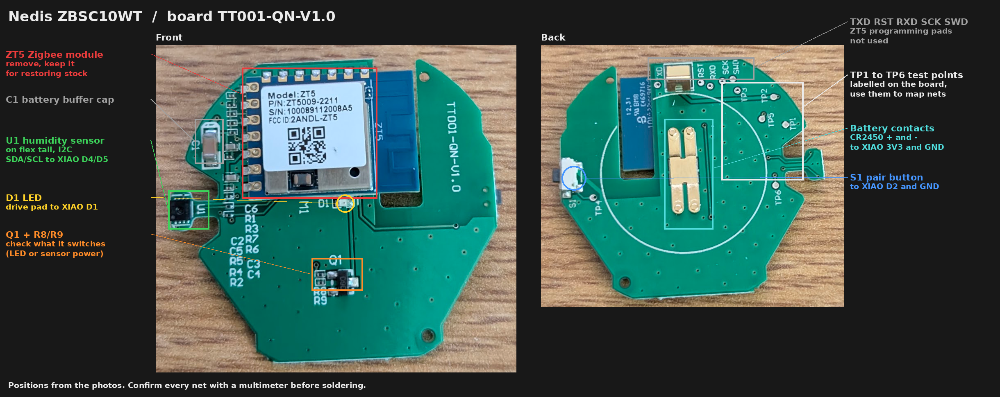

# Nedis ZBSC10WT climate sensor: ESPHome

ESPHome firmware for the Nedis ZBSC10WT Zigbee temperature and humidity sensor. The stock Tuya ZT5 module is replaced with a Seeed XIAO nRF52840 running ESPHome as a sleepy Zigbee end device. The original humidity sensor, button, LED, case and CR2450 coin cell stay.

The result pairs with your own Zigbee coordinator like the original, but runs firmware you control.



## Status

| Item | State |
|---|---|
| ESPHome config validation | Passes (`esphome config`, ESPHome 2026.10.1) |
| C++ code generation | Passes (`esphome compile --only-generate`) |
| Full firmware build for the nRF52840 | Not yet run |
| Built and tested on the device | Not yet |
| Humidity sensor chip | Unmarked. Identify it with the I2C scan in step 4. |
| Sleep current on a coin cell | Unproven. Measure it in step 8 before trusting a CR2450. |

## Contents

| File | Purpose |
|---|---|
| `nedis-zbsc10wt.yaml` | ESPHome configuration |
| `zbsc10wt-board.png` | Both sides of the board with every relevant part marked |

There is no `secrets.example.yaml`. A Zigbee device needs no Wi-Fi credentials or API key.

## Hardware

| Part | Details |
|---|---|
| Device | Nedis ZBSC10WT (Tuya TS0201, `_TZ3000_fie1dpkm`) |
| Power | 1x CR2450, 3 V |
| PCB marking | `TT001-QN-V1.0` |
| Zigbee module | Tuya ZT5: Z2 chip, Arm Cortex-M33, 1 MB flash, 14 pins on a 2 mm pitch, 1.9 to 3.6 V |
| Humidity sensor | U1, 8-pin package on a flex tail, I2C, no readable marking |
| Button | S1, on the back, at the edge of the board |
| LED | D1, below the module |
| Q1, R8, R9 | Small transistor stage below D1. Find out in step 1 what it switches. |
| Test points | TP1 to TP6 on the back, labelled |
| Programming pads | `TXD RST RXD SCK SWD` on the back, for the ZT5. Not used. |

### Why a module swap

ESPHome does not run on the ZT5's Z2 chip, so this device cannot be reflashed in place.

Wi-Fi is not an option either. A CR2450 cannot deliver the 300 mA bursts Wi-Fi needs, so an ESP32-C3 or ESP8266 would need bigger batteries and a new case.

ESPHome runs Zigbee end devices on the nRF52840 since 2026.1, including a sleepy mode that turns the radio off between polls. That keeps the coin cell and the original case.

An ESP32-H2 also runs ESPHome Zigbee, but its sleepy mode is not supported yet. It would rejoin the network on every wake and use more battery.

### Differences from the stock firmware

| | Stock | ESPHome |
|---|---|---|
| Pairs with | Any Zigbee coordinator | Any Zigbee coordinator |
| Temperature and humidity in Zigbee2MQTT | Standard climate clusters | Generic Analog Input endpoints, one per entity |
| Report interval | Fixed by the module | Set in the config (`report_interval`) |
| Firmware updates | From the vendor | From your config |

On the nRF52, ESPHome exposes sensors as generic Analog Input clusters. Readings arrive in Zigbee2MQTT and Home Assistant with their names and units, but not as the device classes the stock sensor used. The entity names in this config contain no spaces, so Zigbee2MQTT versions before 2.8.0 work too.

## Parts and tools

- Seeed Studio XIAO nRF52840, the plain version. The Sense version has a microphone and IMU that cost standby current.
- Thin insulated wire (30 AWG wire-wrap or enamelled wire)
- Kapton tape
- Hot air station or desoldering braid and flux
- Multimeter that can measure µA
- USB-C cable

```bash
pip install --upgrade esphome
```

## 1. Map the board

Take the battery out. With the module still fitted, beep out these nets and write them down:

| Net | Find it at | Goes to on the XIAO |
|---|---|---|
| Battery + | Battery contact, C1 | 3V3 |
| Battery - | Battery contact, C1 | GND |
| Sensor SDA | Flex tail, traced to a ZT5 pin | D4 (P0.04) |
| Sensor SCL | Flex tail, traced to a ZT5 pin | D5 (P0.05) |
| Sensor VDD | Flex tail | 3V3, or see Q1 below |
| Sensor GND | Flex tail | GND |
| Button | S1, the side that is not ground | D2 (P0.28) |
| LED | D1, the side driven from the module or from Q1 | D1 (P0.03) |

The ZT5's pins are: VCC (two pins), GND (two pins), B1, B4, B5, B7, C2 (UART TX), C3 (UART RX), C4 (ADC), D2, RST and SWS. Two of the GPIOs carry I2C to the sensor.

**Q1.** If Q1 sits between the battery and the sensor's VDD, the stock firmware switches the sensor off between readings. The simplest approach is to wire the sensor's VDD straight to 3V3. Most humidity sensors draw under 1 µA when idle. If Q1 drives the LED, leave it and connect the XIAO's D1 to the pin that drove Q1's base or gate.

## 2. Keep the original

Before removing anything, take clear photos of both sides. The ZT5 is not damaged by careful removal. Keep it in a labelled bag. Soldering it back restores the stock device.

## 3. Flash the XIAO

Flash the XIAO before it goes into the device, while it is easy to reach.

1. Connect the XIAO to the computer with USB-C. Nothing else is connected yet.
2. Run:

```bash
esphome run nedis-zbsc10wt.yaml
```

3. Choose the XIAO's serial port when asked. If the upload fails, double-tap the XIAO's reset button to enter the bootloader and run the command again.

## 4. Bench test with the sensor

1. Unplug USB.
2. Remove the ZT5 with hot air, or with braid and flux on each pin. Lift it straight up and keep it.
3. Solder four wires from the sensor nets (SDA, SCL, VDD, GND) to the XIAO, following your map from step 1.
4. Plug the XIAO into USB. **The battery must not be in the holder.**
5. Watch the log:

```bash
esphome logs nedis-zbsc10wt.yaml
```

6. Find the I2C scan near the top, a line such as `Found i2c device at address 0x44`. Set `sensor_platform` and `sensor_address` from this table:

| Address | Platform | Typical chips |
|---|---|---|
| `0x44` or `0x45` | `sht3xd` (try `sht4x` if readings fail) | SHT30, SHT31, SHT40 |
| `0x70` | `shtcx` | SHTC3 |
| `0x38` | `aht10` | AHT10, AHT20 |
| `0x40` | `hdc1080` | HDC1080 |

If the address matches none of these, or the platform reports errors, the chip may be a CHT8305 or CHT8310. ESPHome has no built-in component for those. Open an issue with the address and a photo of the chip.

7. Flash again (step 3) after changing the sensor, and check that Temperature and Humidity show sensible values in the log.

## 5. Wire it in

Unplug USB. Finish the wiring from your map:

| XIAO | Board |
|---|---|
| 3V3 | Battery + |
| GND | Battery - |
| D4 | Sensor SDA |
| D5 | Sensor SCL |
| D2 | S1 (other side of S1 to GND) |
| D1 | LED drive |

The XIAO runs straight from the coin cell through its 3V3 pin, without its own regulator. That keeps the battery measurement simple: the chip's supply voltage is the battery voltage.

Put Kapton tape under the XIAO where the ZT5 was, and keep its antenna end clear of the battery contacts and other metal.

## 6. Switch to the battery build

In `nedis-zbsc10wt.yaml` set:

```yaml
  log_level: INFO
  log_baud_rate: "0"
```

`log_baud_rate: "0"` keeps the USB stack off. Flash once more over USB (step 3) with the battery out.

## 7. Pair

1. In Zigbee2MQTT, enable **Permit join**.
2. Insert the CR2450.
3. The device joins and the LED flashes once.

To leave the current network and pair again, hold the button while inserting the battery.

## 8. Check the sleep current

A CR2450 holds about 600 mAh. The sleep current decides whether the cell lasts years or days.

1. Take the battery out and put the multimeter (µA range) in series between the battery and its contact.
2. Wait for a report to finish. The device wakes for about 10 seconds per `report_interval`.
3. Read the current between wakes.

| Reading between wakes | Expected battery life |
|---|---|
| Under 20 µA | Over a year |
| Around 100 µA | Several months |
| Several mA | Days. Earlier ESPHome releases had a known sleep current issue on the nRF52840. Check that ESPHome is up to date and report the reading. |

## Home Assistant entities

The entities come through Zigbee2MQTT.

| Entity | Unit | Source |
|---|---|---|
| Temperature | °C | Humidity sensor |
| Humidity | % | Humidity sensor |
| Voltage | V | Battery voltage, measured as the chip's supply |
| Battery | % | Voltage mapped from `battery_empty` to `battery_full` |

Any change to the config (new entity, renamed entity) requires removing the device in Zigbee2MQTT and pairing it again.

## Configuration

Substitutions at the top of `nedis-zbsc10wt.yaml`:

| Key | Default | Purpose |
|---|---|---|
| `name` | `climate-bedroom` | Node name, also the Zigbee model identifier |
| `friendly_name` | `Climate Bedroom` | Display name |
| `sensor_platform` | `sht3xd` | ESPHome platform for the humidity sensor (step 4) |
| `sensor_address` | `0x44` | I2C address from the scan (step 4) |
| `report_interval` | `5min` | Wake, measure and report this often |
| `log_level` | `DEBUG` | `INFO` for the battery build |
| `log_baud_rate` | `115200` | `0` for the battery build |
| `battery_full` | `3.0` | Voltage shown as 100 % |
| `battery_empty` | `2.2` | Voltage shown as 0 % |

Other settings and why they are there:

| Setting | Reason |
|---|---|
| `zigbee: power_source: BATTERY`, `sleepy: true` | Tells the coordinator this is a sleeping end device and turns the radio receiver off between polls |
| `deep_sleep: run_duration: 10s` | Awake time per wake for measuring and reporting. The Zigbee stack wakes the chip if needed. |
| `adc: pin: VDD` | Measures the chip's supply, which is the battery |
| `on_boot` button check | Button held at power-up leaves the network for re-pairing |
| `on_join` LED | One flash confirms the device joined |

## Troubleshooting

| Symptom | Cause and fix |
|---|---|
| Upload fails | Double-tap reset on the XIAO to enter the bootloader, then run `esphome run` again |
| No I2C device found | SDA and SCL swapped, sensor VDD not connected, or VDD still switched off by Q1. Wire sensor VDD straight to 3V3. |
| Device does not join | Permit join not enabled, or the device is still joined to an old network. Hold the button while inserting the battery. |
| Entities missing or named wrong after a config change | Remove the device in Zigbee2MQTT and pair it again |
| Device stuck in a boot loop after a config change | Add `wipe_on_boot: once` under `zigbee:`, flash, pair, then remove the line and flash again |
| Battery drains in days | Sleep current too high. Check step 8, that `log_baud_rate` is `"0"`, and that the plain XIAO (not Sense) is used. |
| Battery % jumps around | Coin cell voltage sags while the radio transmits. Adjust `battery_empty` and `battery_full` to your readings. |

## Restoring the stock firmware

Remove the XIAO and its wires, clean the pads, and solder the ZT5 back in its original orientation (compare with your photos from step 2). If sensor VDD was rewired past Q1, restore that connection too.

## Safety

- **Never connect USB while the CR2450 is in the holder.** The XIAO would feed its 3.3 V back into the coin cell. Lithium coin cells are not rechargeable, and charging one can make it leak, swell or catch fire.
- Use a fresh CR2450 from a known brand. Cheap cells sag hard under radio load and cause rejoins.
- Keep coin cells away from children. Swallowed coin cells cause severe internal burns within hours.

## License

Configs: GPL-3.0-or-later. Documentation and images: CC BY-SA 4.0. See [License](../README.md#license) in the repository README.

## References

- Zigbee2MQTT device page for the stock sensor: https://www.zigbee2mqtt.io/devices/ZBSC10WT.html
- Zigbee device database entry (TS0201, `_TZ3000_fie1dpkm`): https://zigbee.blakadder.com/Nedis_ZBSC10WT.html
- Tuya ZT5 module datasheet: https://fcc.report/FCC-ID/2ANDL-ZT5/5355358.pdf
- ESPHome Zigbee component: https://esphome.io/components/zigbee/
- ESPHome nRF52 Zigbee end device guide: https://botmonster.com/smart-home/esphome-zigbee-nrf52-end-device/
- nRF52840 Zigbee sleep current issue: https://github.com/esphome/esphome/issues/17241
- Device power management for nRF52 deep sleep: https://github.com/esphome/esphome/pull/19494
