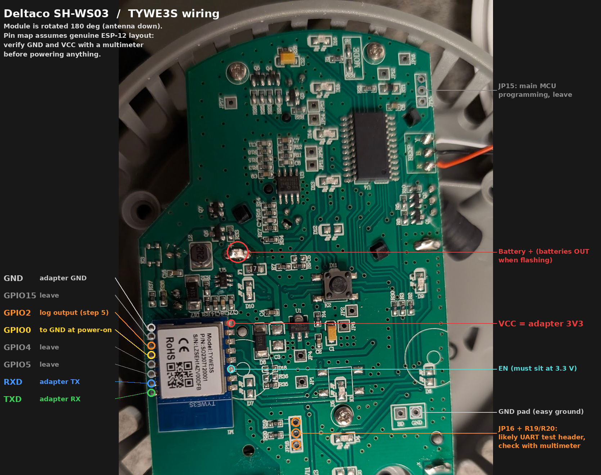

# Deltaco SH-WS03 smoke alarm: ESPHome

ESPHome firmware for the Deltaco Smart Home SH-WS03 Wi-Fi smoke alarm. It replaces the firmware on the TYWE3S Wi-Fi module and reports smoke, fault and battery state to Home Assistant over the local network.

Smoke detection and the siren run on the alarm's own main controller and are not changed. Only the Wi-Fi module is reflashed.



## Status

| Item | State |
|---|---|
| ESPHome config validation | Passes (`esphome config`, ESPHome 2026.10.1) |
| Protocol code | Generated by ESPHome, compiled natively with `-Wall -Wextra`, 25 simulated checks pass (`tests/run_tests.sh`) |
| Full firmware build for the ESP8266 | Not yet run |
| Tested on the device | Not yet |
| Datapoint numbers and smoke polarity | Tuya smoke alarm standard; confirm with step 2 |

## Contents

| File | Purpose |
|---|---|
| `deltaco-sh-ws03.yaml` | ESPHome configuration |
| `secrets.yaml` | Wi-Fi, API and OTA secrets template |
| `tuya_sniff.py` | Captures and decodes the traffic between the main controller and the module |
| `sh-ws03-wiring.png` | Board photo with every connection marked |
| `tests/run_tests.sh` | Generates the ESPHome C++ and runs the protocol tests |
| `tests/harness.cpp` | Native test harness for the protocol code |
| `tests/test_sniff.py` | Test for `tuya_sniff.py` |

## Hardware

| Part | Details |
|---|---|
| Device | Deltaco Smart Home SH-WS03 |
| Power | 2x AAA (LR03) |
| PCB marking | `CW511YG_2 V11`, `XCW20190313` |
| Wi-Fi module | Tuya TYWE3S (ESP8266, ESP-12 compatible pinout) |
| Main controller | U4, 28-pin SOP, no part marking |
| Smoke front end | U3, MCP6002 dual op-amp next to the smoke chamber |
| Power stage | L2 (2R2) with U5 boost converter, SS14 diode, U1 SOT-89 regulator marked `7123-1` |
| Buzzer | Wired to the `BEEP` pads (Y, B, R) |
| Button | K2, centre of the board. Hold about 3 s to test, about 5 s for reset and pairing. |
| `MODE` block | Resistor option pads (R8/R29), not a button |

### How the device works

The main controller keeps the Wi-Fi module switched off almost all the time. When it has something to report (alarm, test, battery level), it powers the module, waits for it to join the network, sends the datapoints over UART at 9600 baud, and cuts power again. Each wake lasts a few seconds.

The controller speaks the Tuya low-power serial protocol (version byte `0x00`, commands `0x01`, `0x02`, `0x05`, `0x08`). The standard ESPHome `tuya:` component does not support this protocol, so the config handles it directly.

After a report is delivered, the firmware disconnects from Home Assistant cleanly and puts the module into deep sleep. Home Assistant treats a clean disconnect from a sleeping device as expected and keeps the last values. If the power is cut first, the entities show as unavailable until the next wake.

## Pinout

The module is mounted rotated 180 degrees, with the antenna pointing towards the bottom of the board. The silkscreen "TYWE3S" on the antenna reads upside down, which confirms the orientation.

### Left column (board edge), top to bottom

| # | Pin | Use |
|---|---|---|
| 1 | GND | Adapter GND |
| 2 | GPIO15 | Leave unconnected |
| 3 | GPIO2 | ESPHome log output after flashing (UART1, 115200) |
| 4 | GPIO0 | Connect to GND at power-on to enter flash mode |
| 5 | GPIO4 | Not used |
| 6 | GPIO5 | Not used |
| 7 | RXD | Adapter TX. Carries data from the main controller. |
| 8 | TXD | Adapter RX. Closest to the antenna. |

### Right column, top to bottom

| # | Pin | Use |
|---|---|---|
| 1 | VCC | Adapter 3V3 |
| 2 | GPIO13 | Not used |
| 3 | GPIO12 | Not used |
| 4 | GPIO14 | Not used |
| 5 | GPIO16 | Not used |
| 6 | EN | Must read 3.3 V when powered |
| 7 | ADC | Not used |
| 8 | RST | Not used |

### Other board landmarks

| Marking | Location | Notes |
|---|---|---|
| `GND` pad (next to `BD`) | Bottom right | Convenient ground point |
| JP16 | Below the module, three through-holes | Two holes run through series resistors R19 (`102`, 1 kΩ) and R20 (`201`, 200 Ω). Likely a UART test header; confirm with a multimeter. The square hole is probably GND. |
| JP15 | Top right, beside U4 | Main controller programming header. Do not use. |
| Battery `+` | Large solder pad left of centre, marked `+` | Batteries must be out while flashing |

### Some TYWE3S modules use a different pinout

Some newer modules labelled TYWE3S contain an ESP8285 and have RX, TX and GPIO0 on different pins. They can't be told apart from the outside. If flashing fails completely with correct wiring, this variant is the likely cause.

## Requirements

- USB to serial adapter switchable to 3.3 V (CP2102 or CH340 with a proper regulator; small FTDI clones may not supply enough current)
- Soldering iron, thin wire
- Multimeter
- Python 3

```bash
pip install --upgrade esptool esphome pyserial
```

### Adapter used: 6-pin CP2102 board

Pins: `DTR`, `RXD`, `TXD`, `+5V`, `GND`, `3V3`. The logic levels are 3.3 V, so no jumper needs setting.

| Adapter pin | Use |
|---|---|
| `3V3` | Module VCC when flashing. Taken from the CP2102's internal regulator, which supplies only about 100 mA. That is enough for the bootloader, not for Wi-Fi. |
| `GND` | Ground |
| `TXD` | Module RXD (step 3) |
| `RXD` | Module RXD (step 2), module TXD (step 3), module GPIO2 (step 5) |
| `+5V` | Never connect |
| `DTR` | Not used |

Before connecting it to the board, check the adapter:

1. Plug it in. On Linux, `dmesg | tail` should show `cp210x` and `ttyUSB0`. If the port is permission denied, run `sudo usermod -aG dialout $USER` and log in again.
2. Bridge `TXD` to `RXD` with a jumper, run `python3 -m serial.tools.miniterm /dev/ttyUSB0 115200` and type. Echoed characters mean the adapter works. Remove the jumper.
3. Measure `3V3` to `GND`: it should read about 3.3 V.

Wiring: put the female end of a jumper on the adapter pin. Cut the other end off, strip it, and solder it to the board. Use the breadboard's blue rail as a common ground for adapter `GND`, the board `GND` pad and the GPIO0 wire.

If esptool drops out or the module keeps resetting during flashing, the 3V3 pin is not supplying enough current. Power the module from a separate 3.3 V regulator (for example an AMS1117 board fed from `+5V`) and keep the grounds connected.

The commands below use esptool 5 syntax (`read-flash`, `write-flash`). Older versions use underscores (`read_flash`).

## 1. Check the pinout

With no power applied:

1. Beep the top-left module pin against the `GND` pad. It must connect. If it doesn't, the module orientation differs from this guide; stop and recheck.
2. Beep the top-right module pin against battery `+`. It should not connect directly; the module supply is switched by the main controller.
3. Beep each JP16 hole against the module RXD and TXD pins. If two holes connect, JP16 can be used instead of soldering to the module pins.
4. Note which side of R19 and R20 connects to the module. They are the first thing to lift if flashing fails (see Troubleshooting).

## 2. Capture the datapoints (stock firmware, batteries in)

This step confirms the datapoint numbers and the smoke polarity before the stock firmware is erased.

Wiring (do not connect adapter 3V3 or TX):

| Adapter | Board |
|---|---|
| GND | GND pad |
| RX | Module RXD |

```bash
python3 tuya_sniff.py /dev/ttyUSB0 | tee capture.log
```

1. Hold the button for about 3 seconds to run a test. Wait for the siren to stop.
2. Keep the capture running for another minute to see whether a "normal" report follows the alarm.
3. Hold the button for about 5 seconds to enter pairing mode, and note how long the module stays powered.

What to look for:

| Output | Meaning |
|---|---|
| `v0` with `0x05` or `0x08` | Low-power protocol. The config in this repo applies. |
| `v3` with `0x07` | Standard protocol. The config needs to use the ESPHome `tuya:` component instead. |
| `0x03` or `0x04` | Pairing request from the button hold |
| `dp1=...` during the test | Smoke datapoint and its alarm value |
| `dp11=...` | Fault state |
| `dp14=...` | Battery state (0 low, 1 middle, 2 high) |
| `dp15=...` | Battery percentage, if this model reports it |

Update the `dp_*` and `smoke_alarm_value` substitutions in `deltaco-sh-ws03.yaml` if the capture differs from the defaults. Keep `capture.log`; it is useful if anything needs changing later.

## 3. Back up the stock firmware

Remove the batteries. Wire for flashing:

| Adapter (3.3 V) | Board |
|---|---|
| 3V3 | Module VCC |
| GND | GND pad or module GND |
| TX | Module RXD |
| RX | Module TXD |
| GND | Module GPIO0, held at power-on |

Connect GPIO0 to GND, then power the adapter. Check the connection:

```bash
esptool --port /dev/ttyUSB0 chip-id
esptool --port /dev/ttyUSB0 flash-id
```

`chip-id` should report an ESP8266. `flash-id` shows the flash size, normally 1 MB on a TYWE3S.

Read the whole flash:

```bash
esptool --port /dev/ttyUSB0 --baud 115200 read-flash 0 ALL sh-ws03_stock_backup.bin
```

Power cycle with GPIO0 held low between commands if the module drops out of flash mode. Keep the backup file safe. It is the only way back to the original firmware.

## 4. Flash ESPHome

Fill in `secrets.yaml`. Generate the API key with:

```bash
python3 -c "import secrets,base64;print(base64.b64encode(secrets.token_bytes(32)).decode())"
```

Set a free static IP in the `substitutions` block of `deltaco-sh-ws03.yaml`, then erase and flash (GPIO0 held low at power-on each time):

```bash
esptool --port /dev/ttyUSB0 erase-flash
esphome run deltaco-sh-ws03.yaml --device /dev/ttyUSB0
```

Without a local install, use Docker:

```bash
docker run --rm -it -v "$PWD":/config --device=/dev/ttyUSB0 ghcr.io/esphome/esphome run deltaco-sh-ws03.yaml --device /dev/ttyUSB0
```

On Windows replace `/dev/ttyUSB0` with the `COMx` port.

## 5. Test

1. Remove the GPIO0 wire.
2. Move adapter RX to module GPIO2. Keep GND connected. Disconnect adapter 3V3 and TX.
3. Insert the batteries.
4. Open the log:

```bash
python3 -m serial.tools.miniterm /dev/ttyUSB0 115200
```

5. Hold the button for about 3 seconds. Expected log lines:

```
[D][mcu] TX 55.AA.00.01.00.00.00 (7)
[I][mcu] Product: {"p":"...","v":"..."}
[D][mcu] TX 55.AA.00.02.00.01.03.05 (8)
[D][mcu] TX 55.AA.00.02.00.01.04.06 (8)
[I][mcu] Datapoints: dp1=0/t4 ...
[D][mcu] TX 55.AA.00.05.00.01.00.05 (8)
[I][mcu] Report delivered, sleeping until the next wake
```

6. Confirm that the Smoke entity changes in Home Assistant and that the entities stay available after the module sleeps.
7. Reassemble and run one more test.

## Home Assistant entities

| Entity | Type | Source |
|---|---|---|
| Smoke | Binary sensor, `smoke` | dp1 |
| Fault | Binary sensor, `problem` | dp11, any non-zero value |
| Battery low | Binary sensor, `battery` | dp14 = 0 |
| Battery level | Text sensor (low, middle, high) | dp14 |
| Battery | Sensor, % | dp15 |
| Wi-Fi signal | Sensor, diagnostic | Module |
| Last MCU report | Text sensor, diagnostic | Every datapoint in the last report, as `dpN=value/tType` |
| MCU product info | Text sensor, diagnostic | Product query reply |

Datapoints without a dedicated entity still appear in Last MCU report, including any self-test result the controller sends.

## Configuration

Substitutions at the top of `deltaco-sh-ws03.yaml`:

| Key | Default | Purpose |
|---|---|---|
| `name` | `smoke-alarm-hallway` | ESPHome node name |
| `friendly_name` | `Smoke Alarm` | Name in Home Assistant |
| `static_ip` | `10.0.0.60` | Fixed address, shortens each wake |
| `gateway`, `subnet` | `10.0.0.1`, `255.255.255.0` | Network |
| `dns1`, `dns2` | `10.0.0.5`, `10.0.0.6` | DNS servers |
| `dp_smoke` | `1` | Smoke datapoint |
| `smoke_alarm_value` | `0` | Value that means alarm (Tuya standard is 0; some models use 1) |
| `dp_fault` | `11` | Fault datapoint |
| `dp_battery_state` | `14` | Battery state datapoint |
| `dp_battery_percent` | `15` | Battery percentage datapoint |
| `api_wait_ms` | `20000` | Report "connected" to the controller after this long even without Home Assistant, so it never times out |
| `sleep_after_report_ms` | `250` | Quiet time after the last report before the clean disconnect and sleep |

Other settings and why they are there:

| Setting | Reason |
|---|---|
| `logger: hardware_uart: UART1` | UART0 is used by the controller; logs go to GPIO2 |
| `safe_mode: disabled: true` | A wake can end with a power cut. ESPHome would count each one as a failed boot and enter safe mode after a few wakes. |
| `deep_sleep:` | Marks the device as sleeping in Home Assistant and provides the clean disconnect. `run_duration: 10min` is a fallback for bench use only. |
| `api: reboot_timeout: 0s`, `wifi: reboot_timeout: 0s` | No reboot loops while waiting for a connection |
| `wifi: fast_connect: true` plus static IP | Shorter wake time, better battery life |

## Protocol summary

Frame format: `55 AA 00 <cmd> <len_hi> <len_lo> <data> <checksum>`. The checksum is the sum of all preceding bytes modulo 256. 9600 baud, 8N1.

| Cmd | Direction | Purpose | Handling in this config |
|---|---|---|---|
| `0x01` | Module to MCU | Product info query | Sent at boot, retried 3 times |
| `0x02` | Module to MCU | Network status | `03` when Wi-Fi is up, `04` when Home Assistant is connected or after `api_wait_ms`; retried 3 times |
| `0x03` | MCU to module | Reset Wi-Fi | Acknowledged; module stays awake |
| `0x04` | MCU to module | Pairing mode | Acknowledged; module stays awake |
| `0x05` | MCU to module | Real-time datapoint report | Published, acknowledged after 300 ms |
| `0x06` | MCU to module | Local time request | Answered from Home Assistant time, or "not available" before sync |
| `0x08` | MCU to module | Record datapoint report (7-byte time header) | Published, acknowledged after 300 ms |
| `0x0B` | MCU to module | Signal strength request | Answered from Wi-Fi RSSI |

The 300 ms delay before acknowledging gives the API time to send the new state before the controller can cut power. Once Home Assistant is connected, a report has been acknowledged and `sleep_after_report_ms` has passed without new traffic, the module disconnects and sleeps.

## Running the tests

```bash
tests/run_tests.sh
```

The script generates the C++ from the YAML with ESPHome, extracts the protocol code and runs it against simulated controller traffic. It covers framing, checksums, retries, line noise, all handled commands, datapoint parsing, the wait for Home Assistant, pairing and sleep timing. Expected frames come from the Tuya protocol documentation. It also runs `tuya_sniff.py` against a recorded byte stream.

## Troubleshooting

| Symptom | Cause and fix |
|---|---|
| esptool cannot connect | The controller holds RX or TX. U4 has no marking, so its reset pin cannot be looked up. Lift R19 and R20 instead (confirm first that they sit on the UART lines), flash, then refit them. Related models need the same step: YG400A removes R4/R5. |
| esptool cannot connect, wiring verified | EN not high: measure EN and tie it to VCC if needed. Otherwise the module may be the ESP8285 variant with a different pinout. |
| Module resets during flashing | Adapter cannot supply enough current. Use an adapter with a stronger 3.3 V regulator or a separate 3.3 V supply with shared ground. |
| No `Product:` line in the log | Controller not answering. Check that RXD and TXD are not swapped and that R19/R20 were refitted. |
| Status `04` never sent | Home Assistant did not connect within `api_wait_ms`. Check the API key and that the static IP is free. |
| Entities unavailable between wakes | The power was cut before the clean disconnect. Lower `sleep_after_report_ms` (0 sleeps immediately after the acknowledgement). |
| Smoke shows on when idle | Polarity reversed. Change `smoke_alarm_value` to `1`. |
| Smoke stays on after a test or alarm | The controller did not send a clear report. Check `capture.log` from step 2. Related models rarely report the clear state, so an automation may need to reset it. |
| Battery % stays empty | This model does not report dp15. Use Battery level and Battery low instead. |
| Module goes silent after 10 minutes on the bench | `deep_sleep` fallback. Power cycle the module. |

## Updating the firmware

The module is normally awake for only a few seconds, so OTA updates need the pairing window:

1. Hold the button for about 5 seconds. The controller sends a pairing request and the firmware stays awake instead of sleeping.
2. Run `esphome run deltaco-sh-ws03.yaml` and choose the network upload.

How long the controller keeps the module powered in pairing mode is unknown; check it during step 2. If the window is too short, flash over serial with the wiring from step 3.

## Restoring the stock firmware

Wire as in step 3, hold GPIO0 low at power-on, then:

```bash
esptool --port /dev/ttyUSB0 write-flash 0x0 sh-ws03_stock_backup.bin
```

## Safety

- Never flash or probe with the batteries fitted, except for the read-only capture in step 2.
- The alarm logic and siren run on the main controller and keep working regardless of the Wi-Fi firmware. Test after reassembly and then once a month by holding the button for about 3 seconds.
- This firmware adds notifications only. It is not a replacement for a certified alarm system.

## References

- Tuya Wi-Fi low-power serial protocol: https://developer.tuya.com/en/docs/mcu-standard-protocol/mcusdk-wifi-lowpower-powerdown?id=Kdpxm74got3pq
- Tuya smoke alarm (ywbj) standard datapoints: https://developer.tuya.com/en/docs/iot/s?id=K9gf48r5i2iiy
- SH-WS03 user manual (button timings): https://manuals.plus/deltaco/sh-ws03-smart-wifi-manual
- TYWE3S flashing pinout: https://staars.github.io/docs/devices/TYWE3S
- Flashing a TYWE3S with a controller attached: https://tasmota.github.io/docs/TuyaMCU-Devices/
- Alternative TYWE3S / ESP8285 pinout: https://www.elektroda.com/news/news4017662.html
- Nedis WIFIDS10WT (related TYWE3S smoke alarm): https://templates.blakadder.com/nedis_WIFIDS10WT.html
- YG400A (related TYWE3S smoke alarm): https://templates.blakadder.com/YG400A.html
- TY01 (2x AAA TYWE3S sensor): https://templates.blakadder.com/TY01.html
- Tuya smoke detector datapoints, CB3S model: https://www.elektroda.com/rtvforum/topic3995347.html
- Tuya smoke alarm fault datapoint (dp11): https://github.com/tuya/tuya-home-assistant/issues/986
- ESPHome deep sleep component: https://esphome.io/components/deep_sleep.html
